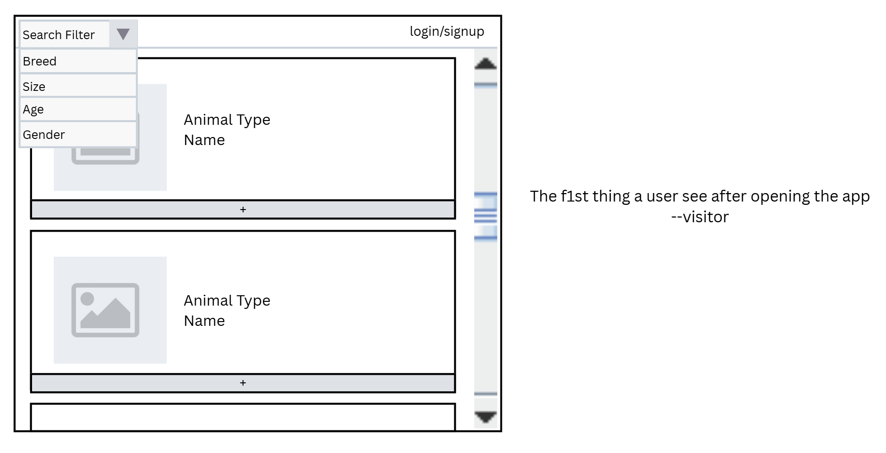
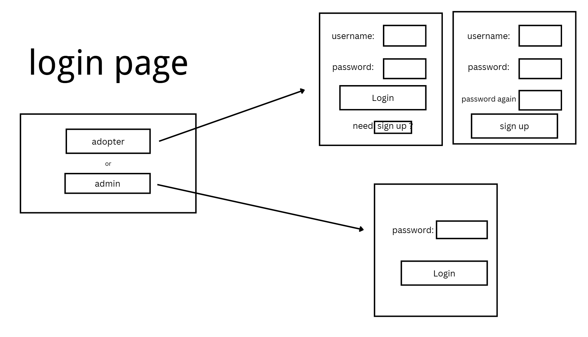
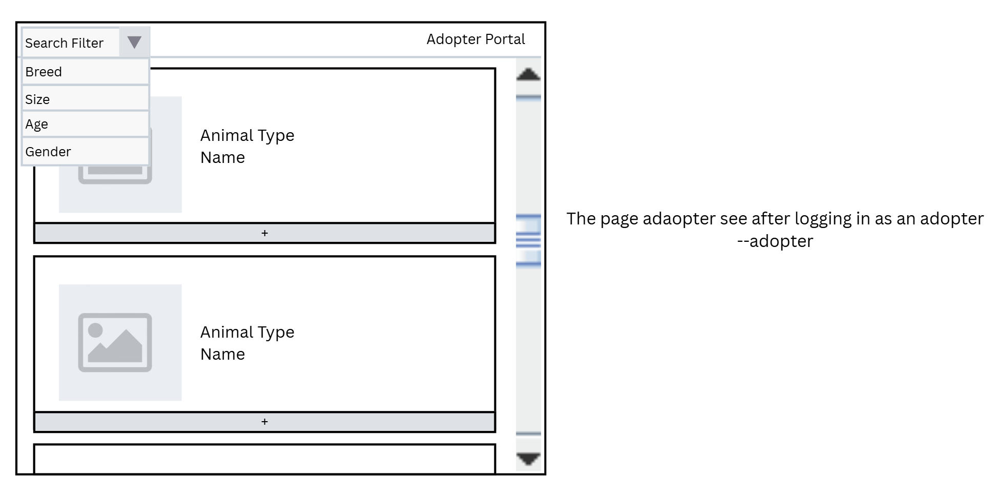
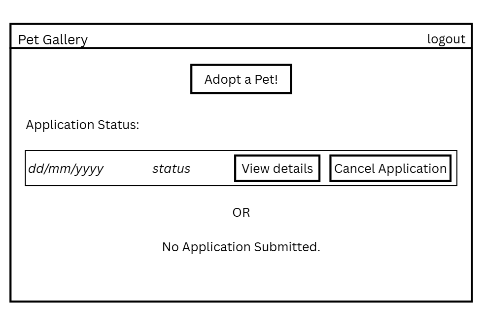
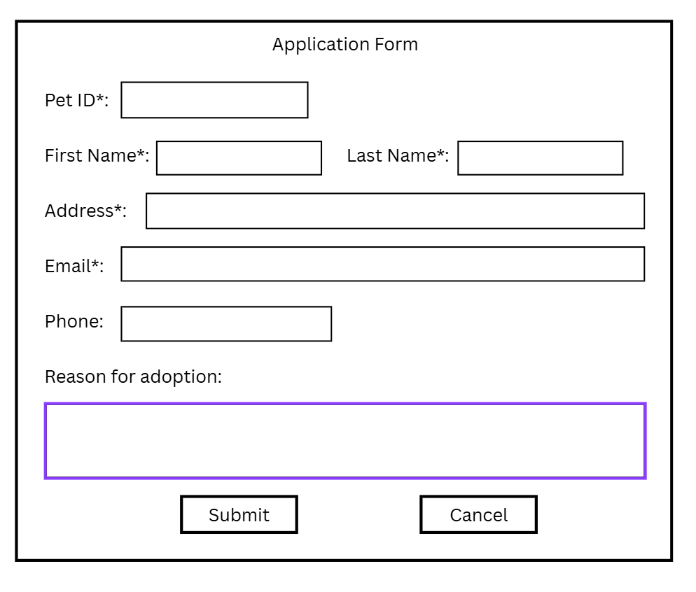
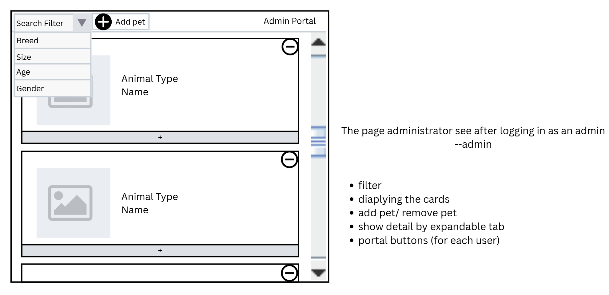
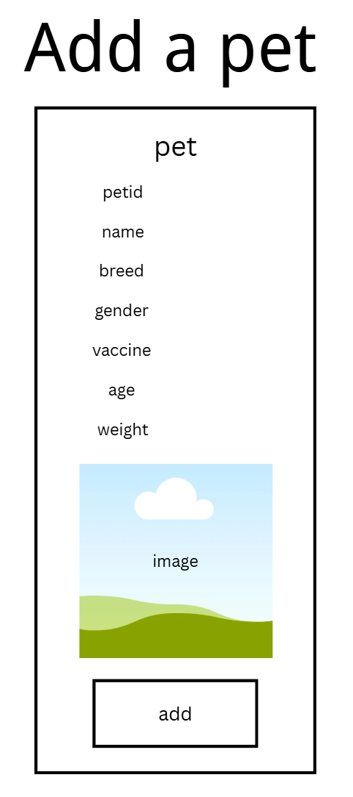
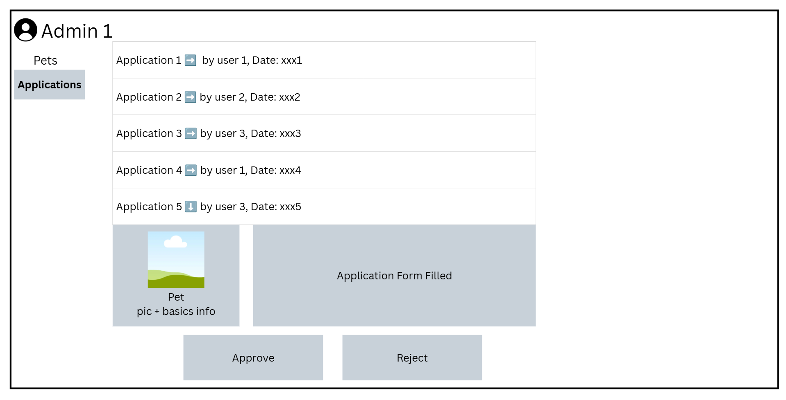

# Team Project

Please keep this up-to-date with information about your project throughout the term.

The readme should include information such as:
- a summary of what your application is all about
- a list of the user stories, along with who is responsible for each one
- information about the API(s) that your project uses 
- screenshots or animations demonstrating current functionality

## Summary
This is a software designed for pet adoption. Users can browse through pets to be adopted and submit an online application form for adoption. The admin staff is going to view each application and either approve or reject them. The decision will be shown on users' portal.

## User stories
1. The users are able to browse all the pets and their information.
2. The users are able to see pets sorted in specific orders (breed, size, age, or gender)
3. The user can click the "+" button below each pet to expand more information about this pet.
4. A visitor can either choose to use an adopter account or an admin account.
5. An adopter can log in their account using username and password.
6. If an adopter does not have an account yet, they can click the "sign up" button to sign up for a new account.
7. A logged-in adopter can log out.
8. A logged-in adopter can check their application status((approved, reject, in-progress)) and date.
9. A logged-in adopter can fill an application form and either "submit" pr "cancel". 
10. The admin staff should enter the correct password to log in as a manager.
11. An admin staff should be able to add a pet by providing its information, including uploading its photo.
12. An admin staff can remove a pet from the gallery.
13. An admin staff can see all the applications.
14. An admin staff can view each application form and decide whether to approve or reject the application.

## Functionality visualized

By keeping this README up-to-date,
your team will find it easier to prepare for the final presentation
at the end of the term.
